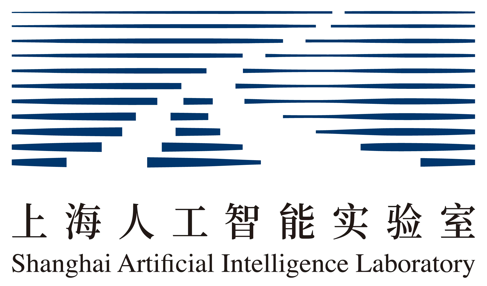








# 👋 Welcome! 
Hi! I am Yu Qian (余谦). I am currently pursuing my PhD at [The University of Sydney](https://www.sydney.edu.au/), under the supervision of [Assoc. Prof. Chang Xu](http://changxu.xyz/). Before that, I completed my M.S. in Information and Communication Engineering at [Dalian University of Technology (DUT)](https://www.dlut.edu.cn/), where I was supervised by [Prof. Lihe Zhang](https://faculty.dlut.edu.cn/lhzhang/zh_CN/index.htm) and [Prof. Huchuan Lu (IEEE Fellow)](https://faculty.dlut.edu.cn/Huchuan_Lu/zh_CN/index.htm) from [IIAU-LAB](https://futureschool.dlut.edu.cn/wljsxy_old/IIAU.htm). Earlier, I received my bachelor's degree from the [School of Computer Science and Technology](https://cs.dlut.edu.cn/), [Dalian University of Technology](https://www.dlut.edu.cn/).

My research interests include fine-grained visual perception and general-purpose multimodal large models. If you are interested in my work, please feel free to contact me! 😄

# 🔥 News
- *2025.01*: &nbsp;🎉🎉 1 paper accepted in ICLR 2025.
- *2024.03*: &nbsp;🎉🎉 2 paper accepted in CVPR 2024. **(1 highlight ~2.8%[324/11532])**

# 📝 Publications 

arXiv

[Intern Lumina U2: A Multi-Codebook Diffusion Large Language Model for Omni-Visual Understanding and Image Generation](https://arxiv.org/pdf/2610.20818)

**Qian Yu***, Zongyang Qiu*, Juncheng Yan*, Hongliang Li*, Qi Qin*, Keqi Wang*, et al.

[**Project**](https://internlm.github.io/InternLumina-U2/) \| [**Code**](https://github.com/InternLM/InternLumina-U2) \|  \| [**Model**](https://huggingface.co/internlm/InternLumina-U2)

ICLR 2025

[High-Precision Dichotomous Image Segmentation via Probing Diffusion Capacity](https://arxiv.org/pdf/2410.10105)

**Qian Yu***, Peng-Tao Jiang*, Hao Zhang, Jinwei Chen, Bo Li, Lihe Zhang, Huchuan Lu

[**Code**](https://github.com/qianyu-dlut/DiffDIS) \| 

CVPR 2024 (Highlight)

[Multi-view Aggregation Network for Dichotomous Image Segmentation](https://openaccess.thecvf.com/content/CVPR2024/papers/Yu_Multi-view_Aggregation_Network_for_Dichotomous_Image_Segmentation_CVPR_2024_paper.pdf)

**Qian Yu***, Xiaoqi Zhao*, Youwei Pang*, Lihe Zhang, Huchuan Lu

[**Code**](https://github.com/qianyu-dlut/MVANet) \| 

CVPR 2024

[Towards Automatic Power Battery Detection: New Challenge, Benchmark Dataset and Baseline](https://arxiv.org/pdf/2312.02528v2)

Xiaoqi Zhao*, Youwei Pang*, Zhenyu Chen, **Qian Yu**, Lihe Zhang, Hanqi Liu, Jiaming Zuo, Huchuan Lu

[**Code**](https://github.com/Xiaoqi-Zhao-DLUT/X-ray-PBD) \| 

# 🎖 Honors and Awards
- *2024* Huawei Special Scholarship (3/152)
- *2022-2024* Postgraduate First-class Scholarship
- *2022* Golden Prize in The 2020 International Genetically Engineered Machine Competition (iGEM)
- *2019-2022* Campus Culture and Sports Awards
- *2022* 🎵 Second Place in Top Ten Singers Contest in Dalian University of Technology

# 📖 Educations
- *2026.10 - Present*, PhD student in Computer Science at [The University of Sydney](https://www.sydney.edu.au/).
- *2022.09 - 2025.06*, M.S. in Information and Communication Engineering at [Dalian University of Technology](https://www.dlut.edu.cn/) .
- *2018.09 - 2022.06*, Received the B.E. in Computer Science and Technology at [Dalian University of Technology](https://www.dlut.edu.cn/) (ranked in the top ~15% with a recommendation for postgraduate studies).

# 💻 Internships

Shanghai AI Lab

**Large Model Center | [Shanghai Artificial Intelligence Laboratory](https://www.shlab.org.cn/)**
- Research Assistant
- Aug. 2025 - Present

VIVO

**[Quality Enhancement Center](https://vivocamera.github.io/) | [VIVO Mobile Communication Co., Ltd.](https://www.vivo.com/)**
- Advised by [Dr.Peng-Tao Jiang](https://pengtaojiang.github.io/)
- Mar. 2024 - Oct. 2024

